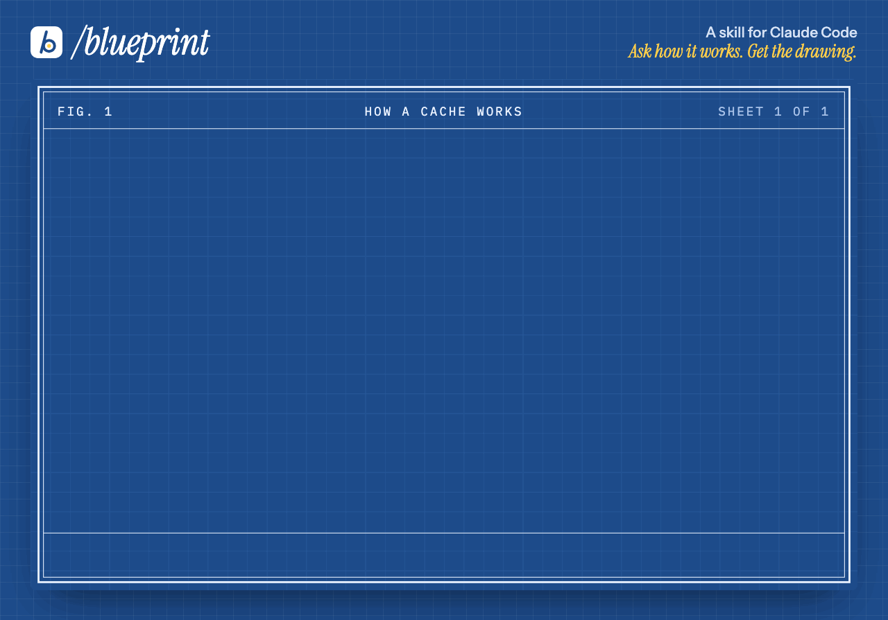
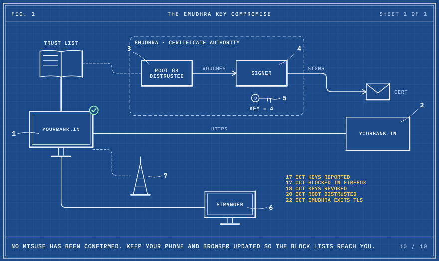
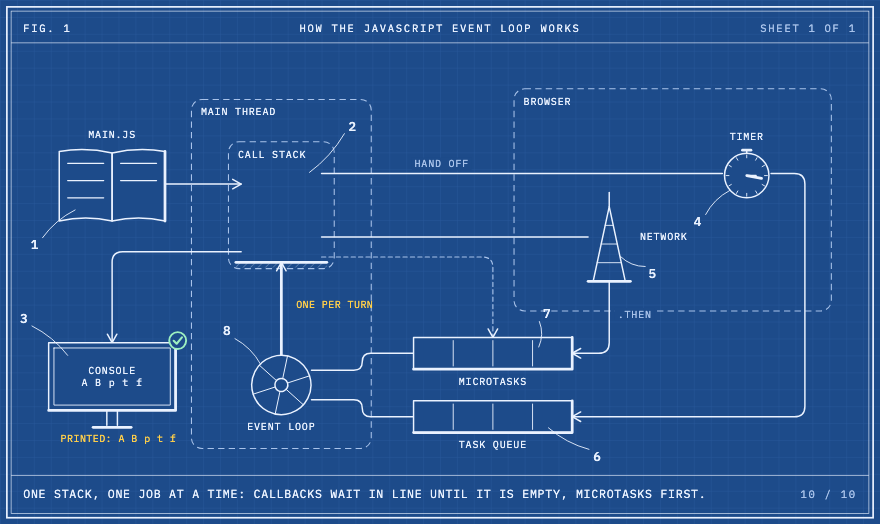
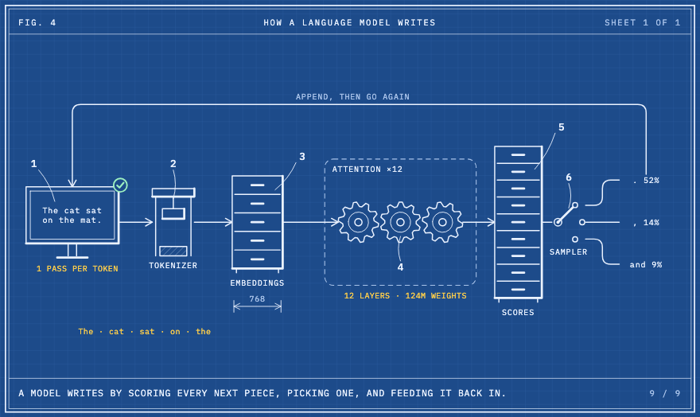

<p align="center">
  
</p>

<h1 align="center">/blueprint</h1>

<p align="center">
  Ask Claude Code how something works. It draws the answer like an old patent sheet, one part at a time.
  <br><br>
  <a href="https://blueprint-skill.vercel.app"><b>Website</b></a> ·
  <a href="https://blueprint-skill.vercel.app/#examples"><b>All 21 examples</b></a> ·
  <a href="#install"><b>Install</b></a>
</p>

<p align="center">
  
</p>

Blueprint is a skill for Claude Code. Give it a topic and it returns an animated explainer: parts drawn in with numbered leader lines, things moving along the lines, and one plain sentence per step. It ships as a single `<blueprint-scene>` element or a standalone HTML file, and the finished sheet still explains the idea as a picture.

## Install

```bash
npx skills add intincrab/blueprint
```

Or clone it into your skills folder:

```bash
git clone https://github.com/intincrab/blueprint.git ~/.claude/skills/blueprint
```

It needs Node. [Playwright](https://playwright.dev) is optional, and lets Claude render frames of a sheet to check its own work.

## Use

```
/blueprint how a cache works
/blueprint our signup flow, for the docs page
/blueprint why the retry storm took the API down
/blueprint the event loop, as a complex scene
```

Claude finds the chain of reasons in the topic, picks parts from a kit of 28 (drawers, cabinets, gears, gates, locks, clocks, queues and more), lays out the sheet, lints it, looks at every step, and then embeds it in your page or exports a file.

## How a sheet is built

Every part has to earn its place. A sheet starts with one real case and adds a part only when the last one falls short:

> The app asks the database for item #42. Every request makes the long trip, and each lookup takes 120 ms. **So** a drawer by the door keeps recent answers. **But** the first time it is empty, **so** it fetches once and keeps a copy. The next request is answered in 2 ms.

That chain of "but… so…" is the explanation, and the animation above is that paragraph drawn.

## Examples

<table>
  <tr>
    <td width="33%"><a href="examples/complex/emudhra.js"></a></td>
    <td width="33%"><a href="examples/complex/event-loop.js"></a></td>
    <td width="33%"><a href="examples/complex/llm.js"></a></td>
  </tr>
  <tr>
    <td><b>The eMudhra key compromise</b><br>A real breach from October 2026, for people who are not engineers</td>
    <td><b>The JavaScript event loop</b><br>Stack, task queue and microtasks</td>
    <td><b>How a language model writes</b><br>Tokens, attention, one word at a time</td>
  </tr>
</table>

Watch any of them at **[blueprint-skill.vercel.app](https://blueprint-skill.vercel.app/#examples)**, where you can step through each one and copy its source.

| Small · 3–6 steps | Complex · 8–10 steps, with camera moves |
|---|---|
| [How a cache works](examples/small/cache.js) | [The eMudhra key compromise](examples/complex/emudhra.js) |
| [Debouncing a search box](examples/small/debounce.js) | [What happens when you open a web page](examples/complex/url.js) |
| [A token bucket rate limiter](examples/small/rate-limit.js) | [How git merges two branches](examples/complex/git-merge.js) |
| [A job queue absorbing a burst](examples/small/queue.js) | [How "Sign in with Google" works](examples/complex/oauth.js) |
| [The call stack](examples/small/call-stack.js) | [How a database survives a crash](examples/complex/transaction-log.js) |
| [A hash map finding a key](examples/small/hash-map.js) | [How a CDN brings files closer](examples/complex/cdn.js) |
| [Retry with exponential backoff](examples/small/retry-backoff.js) | [The JavaScript event loop](examples/complex/event-loop.js) |
| [A load balancer spreading work](examples/small/load-balancer.js) | [An event log with partitions](examples/complex/kafka.js) |
| [A database index finding a row](examples/small/db-index.js) | [A circuit breaker](examples/complex/circuit-breaker.js) |
| [A lock stopping lost updates](examples/small/mutex.js) | [How a compiler turns text into a program](examples/complex/compiler.js) |
| | [How a language model writes](examples/complex/llm.js) |

## Put it on a page

```html
<blueprint-scene scene="cache" play="view" key></blueprint-scene>
<script src="/blueprint/blueprint.js" defer></script>
<script src="/blueprint/cache.js" defer></script>
```

| Attribute | What it does |
|---|---|
| `play` | `loop` (default), `view` (plays once when scrolled into view), `click`, or `still` (the finished sheet) |
| `paper` | `blue` (cyanotype, default) or `linen` (ink on cream) |
| `key` | Shows the numbered parts list under the sheet |
| `no-controls` | Hides the play, step and replay bar |
| `speed` | Playback rate, e.g. `1.25` |

Every sheet has play and pause, previous and next step, and a step bar. With reduced motion turned on it shows the finished sheet. The runtime is one file with no dependencies.

To send a sheet to someone as a single file:

```bash
node scripts/build.mjs examples/small/cache.js --out cache.html
```

## What is in the repo

| Path | Purpose |
|---|---|
| `SKILL.md` | What Claude reads first: the workflow and the style rules |
| `references/craft.md` | The scene format, the part kit, line kinds, step actions, and which part suits which idea |
| `runtime/blueprint.js` | Layout, timeline, SVG renderer and the `<blueprint-scene>` element |
| `templates/scene.js` | A starting scene |
| `scripts/check.mjs` | Lints a scene: unknown ids, overlapping parts, lines through parts, labels off the sheet |
| `scripts/frames.mjs` | Renders chosen moments into one contact sheet (needs Playwright) |
| `scripts/build.mjs` | Turns scenes into one standalone HTML page |
| `examples/` | 10 small and 11 complex scenes |
| `site/` | The website, built with `node site/build.mjs` |
| `video/` | The teaser film and the scripts that render it and the README preview |

## Where the look comes from

Victorian patent drawings for the fine line work, numbered parts and shading. Randall Munroe's *Thing Explainer* for plain words and labels on everything. Bartosz Ciechanowski's explainers for building a machine one part at a time. Bret Victor's *Ladder of Abstraction* for showing one concrete case before the rule. And Kamran Ahmed's [/stick-scene](https://github.com/nilbuild/stick-scene), which this skill's packaging follows.

## License

[MIT](LICENSE). Scenes you make with the skill are yours.
